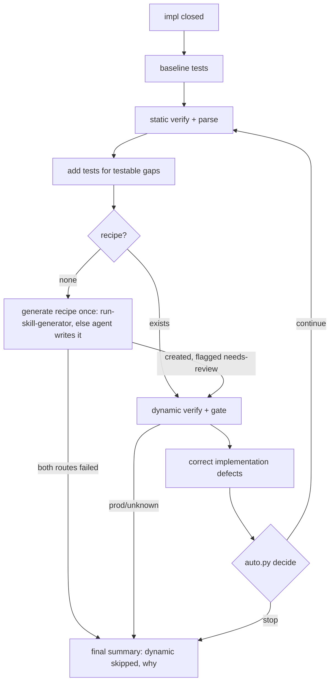

# Technical spec — auto verification mode for spec-implement

Behavior is defined in [functional-spec.md](functional-spec.md); invariant numbers below refer to it. No `research/` directory exists for this initiative.

## Context

`spec-implement` is a prompt-driven orchestrator (`skills/spec-implement/SKILL.md`, 432 lines) plus deterministic helper scripts under `skills/spec-implement/scripts/`. Judgment lives in the SKILL.md prose; bookkeeping (log writes, stall decisions, arg resolution) lives in Python scripts that print `key=value` and exit 2 on error (`speclog.py:15-26`). It ends at Step 7 (`SKILL.md:391-417`) by running `log.py close` and printing a `Next: /spec-verify-static …` pointer.

Constraints that shape the design:

- **The verify skills cannot be invoked by the orchestrator.** Both are `disable-model-invocation: true` (`spec-verify-static/SKILL.md:8`, `spec-verify-dynamic/SKILL.md:8`) and `spec-implement`'s `allowed-tools` is `Read Glob Bash Agent` (`SKILL.md:13`) — no `Skill`. They also end in prompts (recipe menu `spec-verify-dynamic:75-91`, dependency confirmation `:162-174`) that auto mode must not hit.
- **Their reports are already the findings channel.** Both write a fixed-format report (`verify-static-report.md`: `Invariant N — …` / `  Static: covered — f:l | no coverage found`; `verify-dynamic-report.md`: `  Dynamic: pass | fail — … | skip — …`, `spec-verify-static:96-108`, `spec-verify-dynamic:206-218`). Nothing needs to be added to the skills to "return findings".
- **The orchestrator writes no code** (`SKILL.md:56-70`, invariant 42); `guard.py` only warns, and goes silent once all implementation logs are `status: complete` (`guard.py:54-64,88`). Auto mode starts after `log.py close`, so log writes by `log.py`/`auto.py` never trip it.
- `log.py` is the only logbook writer (`log.py:124-138` for `close`); `speclog.write` is atomic (`os.replace`, `speclog.py:36-43`), which gives invariant 38 for free per entry.
- `tdd-red` assumes a test that unexpectedly passes is a TDD violation: it analyses the cause and may write a lesson under `~/.claude/tdd/lessons/` (`agents/tdd-red.md:101-135`). Coverage-gap tests for already-implemented behavior hit this path routinely.
- `/run-skill-generator` is a built-in command, not a file under `skills/` (the dynamic skill only names it in its no-recipe message, `spec-verify-dynamic:66-72`). Built-in commands are generally not exposed to the model via `Skill`, so it may not be callable from an agent; callability is unverified.

## Proposed changes

**Principle: no change to `spec-verify-static`, `spec-verify-dynamic`, agents, or `guard.py`** (invariants 5, 41, 42). Auto mode reuses the verify skills by delegating to a `claude` sub-agent that reads the skill file and follows named steps with explicit overrides in the prompt. The skill files stay the single source of truth for what is checked.

### Argument and flag — `resolve-spec.py`
Strip a standalone `--auto` token from `--arg` in any position before the existing name/path logic (`resolve-spec.py:26-30`); emit `auto=true|false` and, when true, `rounds=<MAX_ROUNDS>`. `MAX_ROUNDS = 2` lives in `speclog.py` (one definition, read by `resolve-spec.py`, `auto.py`). Without the flag, output is unchanged except `auto=false` (invariants 1, 2, 26).

### Decision record — `log.py` writers
New commands, all appending only, never touching existing sections (34):

- `auto-start --log --rounds` — appends `## Auto verification` (first run) and a `### Run <date>` block; later entries belong to the latest run block. Requires `last-completed-phase` frontmatter (else `die`: run is not closed).
- `auto-entry --log --round R --stage static|dynamic --invariant N --text T --decision acted|skipped --action test|correction|none --reason R [--files F…] [--regression]` — one line: `- [r<R>/<stage>] inv <N>: <text> — <decision>: <reason> [files: …]`. Idempotent on `(round, stage, invariant)` within the run block: an identical key returns `status=unchanged` (never rewrites). A recurrence in round 2 has a different key, hence a new entry labeled `r2` (32, 33, 35).
- `auto-note --log --round R --text T` — non-finding events: recipe chosen/generated (flagged `auto-generated, needs review`), dynamic skipped and why, safety stop, regression stop, delegated-step failure (19–21, 24, 37, 39, 44).

### Readers and loop control — new `scripts/auto.py`
- `parse --kind static|dynamic --report PATH` → `total=`, `covered=`/`passed=` and `uncovered=`/`failed=`/`skipped=` as comma-separated invariant numbers (plus `skip_reasons`). Deterministic; replaces the orchestrator eyeballing reports (6, 7, 14, 17).
- `decide --round R --acted K --open IDS [--prev-open IDS]` → `status=continue` or `status=stop reason=clean|no-progress|bound`. Rules: `open` empty and `acted=0` → `clean` (40); `acted=0` and (R=1 or `open == prev-open`) → `no-progress` (27); `R >= MAX_ROUNDS` → `bound` (26); else `continue`. A round with `acted=0` but a changed open set continues, as 27 requires.
- `summary --log PATH` → counts from the latest run block: tests added, corrections, skipped by reason, regression flag, dynamic performed or not (36). Computing from the log guarantees summary and logbook agree (44).

### Control flow — state machine in `scripts/machine.py`, driven by `auto.py next` / `advance`
The loop below is not interpreted from prose. `auto.py next --log L` prints the current state with one action, the agent template or command to use, and the schema the result must match. `auto.py advance --log L --result JSON` validates the result (unknown or missing keys, wrong enum, wrong invariant, a spec file under `files` → `status=error`, nothing written), appends the event, entries and notes, and returns the new state. State is never stored apart from the log: it is rebuilt by replaying `- [rN] event: <STATE> <json>` lines of the latest run block through the pure `step(ctx, payload)`, so a resumed run sees the same state (38). Report parsing happens inside `advance`; the event stores the parsed result, so later overwrites of the report cannot change the replay. `{"error": "..."}` is valid in every state and ends the run at SUMMARY with a `delegated-step failure` note (37). The machine reads invariant texts from `functional-spec.md` itself, so entries cannot carry placeholder text (32).

| State | Orchestrator action | Result | Next |
|---|---|---|---|
| `INIT` | baseline runners | `baseline: green` / `red` / `broken` | `STATIC_RUN` / failure |
| `STATIC_RUN` | static-verify agent | `report` (parsed by `advance`) | `STATIC_CLASSIFY`; none uncovered → preflight |
| `STATIC_CLASSIFY` | classify each uncovered | `testable[]`, `deferred[{inv, why}]` = exactly the uncovered set | `ACT_TEST`, else preflight; deferred logged (9) |
| `ACT_TEST` | coverage-gap cycle | `inv, outcome, files, fix_id[, regression]` | next `ACT_TEST`, else preflight; `regression` → stop |
| `DYN_PREFLIGHT` | find or choose recipe | `recipe, how[, why]` or `recipe: null` | `DEP_GATE` / `RECIPE_GEN` |
| `RECIPE_GEN` | one generation attempt | `recipe, route` or `failed` | `DEP_GATE` / dynamic skipped |
| `DEP_GATE` | dependency map | `deps[{name, class}][, started]` | `DYN_RUN`; production or unknown → stop (24, 43); not started → dynamic skipped |
| `DYN_RUN` | finish dynamic verify | `report` | `TRIAGE` if failures, else decision |
| `TRIAGE` | classify each failure | `findings[{inv, class, evidence[, files]}]` = exactly the failed set | `CORRECT` for defects only (15, 16), else decision |
| `CORRECT` | correction cycle | `inv, files, fix_id[, route, regression]` | next `CORRECT`, else decision; `regression` → stop |
| `SUMMARY` | print summary | `{}` | `DONE` |

The per-round decision is automatic inside the step that precedes it (no orchestrator state): open set = (testable − tested) ∪ (deferred − dynamically passed) ∪ (failed − corrected); `decide` → continue (round + 1, static re-run first, which gives 18), clean/no-progress → `SUMMARY`, bound with acts in the round → closing verify (`STATIC_RUN` → `DEP_GATE` → `DYN_RUN` with `closing=true`, findings logged `skipped: closing verify: not acted on`), bound without acts → `SUMMARY`. Dynamic skipped (no recipe after one attempt, app did not start) also goes through the decision, so a later round can still add static tests (20). Recipe generation is allowed once per run: `gen_tried` is replayed from the log (22). `DYN_RUN` is reachable only from `DEP_GATE` (23–25, 43).

Entries carry `[fix: <id>]`; `summary` counts distinct fix ids, so one fix over several findings counts once (36).

### Orchestration — `references/auto-mode.md`, loaded only when `auto=true`
Now the driver loop (`auto-start`, then `next` → act → `advance` until `DONE`), the judgment each state asks for, and the agent prompt templates. The numbered procedure below is the behavior the machine encodes; it is kept for the rationale behind each step. Keeps the default path of SKILL.md byte-identical in behavior (1, 41). Procedure:

1. **Baseline.** Run each layer's `runner` (from `scan-project.py`) via Bash; red baseline → `auto-note`, stop, hand to user (37). Re-run all runners after every test/correction agent; any new failure → `auto-entry --regression`, `auto-note`, stop (39).
2. **Static pass.** `claude` agent: "Read `skills/spec-verify-static/SKILL.md`, follow Steps 3–7 for `<name>`, write only the report, omit the `Next:` line." Then `auto.py parse`. Orchestrator classifies each uncovered invariant as statically testable or not (judgment, recorded as the `reason`). Not testable → `skipped: deferred to dynamic` (9). Testable → `tdd-red` (+ `tdd-green`/`tdd-refactor` if red is genuinely red) with the prompt override: *"coverage-gap test for behavior that may already exist; an immediate pass is expected — do not run the unexpected-pass/lesson workflow, report `already-green`."* `already-green` skips green and refactor, keeping the change test-only (8). If red fails for real, the behavior is missing and green implements it minimally.
3. **Dynamic preflight (orchestrator).** `Glob .claude/skills/run-*/SKILL.md`. Multiple → apply the comparison in `spec-verify-dynamic` Step 3 (read that section at run time, don't copy it), pick the recommended one, `auto-note` which and why (21). None → one `claude` generation agent, once per run, never overwriting an existing recipe (19, 22): (a) invoke `/run-skill-generator` if callable; (b) if not callable, do the job itself — launch the app from a clean environment, record what worked, write `.claude/skills/run-<name>/SKILL.md`. Either way `auto-note` the route used, flagged `auto-generated, needs review`. Both routes fail → `auto-note`, skip dynamic, go to summary (20).
4. **Dynamic pass.** `claude` agent: follow `spec-verify-dynamic` Steps 4–7 with `<run-recipe>` pre-resolved, with overrides: print the dependency map; **if any dependency is production/unknown, tear the app down via the recipe, exercise nothing, return `gate=blocked deps=…`** (23, 24, 43); otherwise proceed without the yes/no prompt (see Dependency confirmation); no test suites; no `Next:` line. Orchestrator parses the report, triages each failure into exactly one of the four classes (14), and logs one entry per failure and per skip (17).
5. **Corrections.** Only implementation defects (15, 16, 31): `tdd-red` writes a test reproducing the observed failure, `tdd-green` fixes minimally, scoped to the files the finding implicates (30). If no failing test can be written, fall back to a scoped `claude` agent fix and log it as such. A correction forces a static re-run before the next dynamic run (18).
6. **Loop.** After each round's act phase call `auto.py decide`. On `continue`, repeat from step 2 as round R+1. On `stop reason=bound` with any acts in the last round, run one **closing verify** (static, then dynamic if it ran) whose findings are listed in the summary but not acted on (29). A round = verify → act (11); the closing verify is why a bound of 2 still reports the final state truthfully.
7. **Final summary.** Always printed (28), from `auto.py summary` plus the open-invariant list, pointing at `logbook.md` (36). Replaces the `Next:` pointer in auto mode.

### `SKILL.md` edits (small)
`argument-hint` (`:12`) gains `[--auto]`; scripts table (`:44-54`) lists `auto.py`; Step 1 (`:74-80`) reads `auto=`/`rounds=` and, if true, prints `Auto mode active — up to <rounds> verify → act rounds.` (3); Step 7 (`:413-417`) prints `Next:` only when `auto=false`, otherwise continues to a new **Step 8 — Auto verification** that loads `references/auto-mode.md`. Steps 2–6 keep their existing menus and stops (4).

### Tradeoffs
- **Delegate via agent reading the skill file** vs. adding `--auto` to the verify skills: the latter touches standalone behavior (5) and duplicates prompts; the former costs one agent hop per verify.
- **Judgment (testability, triage, recipe choice) stays in prose; counting and stopping move to scripts.** Judgment cannot be unit-tested; loop bounds and log format can, and are where silent drift would hurt.
- **Round 2 actions are verified by a closing verify**, a third verify pass at most per stage. Cheaper alternatives (no closing verify) leave the last actions unchecked.

### Dependency confirmation (invariant 25, resolved)
Auto mode prints the map and proceeds without the yes/no when all dependencies are local/development; the production/unknown stop (24) is the only gate. Implemented as one sentence in `references/auto-mode.md` step 4.

## Implementation sequence

1. skills/spec-implement/scripts/speclog.py — `MAX_ROUNDS`, auto-entry line format and run-block helpers
2. skills/spec-implement/scripts/resolve-spec.py — strip `--auto`, emit `auto=` and `rounds=`
3. skills/spec-implement/scripts/log.py — `auto-start`, `auto-entry`, `auto-note`
4. skills/spec-implement/scripts/auto.py — `parse`, `decide`, `summary`
5. skills/spec-implement/references/auto-mode.md — orchestration procedure
6. skills/spec-implement/SKILL.md — hint, scripts table, Step 1 flag handling, Step 7 branch, Step 8 pointer
7. skills/spec-implement/tests/scenarios.md — manual scenario runbook against a fixture initiative
8. skills/spec-implement/scripts/machine.py — state machine: `step`, `replay`, `normalize`, `decide`
9. skills/spec-implement/scripts/auto.py — `next`, `advance`; report parsers raise instead of exiting

Phases 8–9 are [TDD] (`tests/test_machine.py`, subprocess against `auto.py next`/`advance` with a fixture logbook, functional spec and reports). Phases 1–4 are [TDD] with `skills/spec-implement/tests/test_*.py` (pytest, subprocess against the scripts, paths via `Path(__file__)`); 5–7 have no unit-testable logic.

## Testing and validation

Script-level invariants get pytest; orchestration invariants are LLM-executed prose and are verified by scenario runs where the assertion surface is `logbook.md` plus `git status`.

| Invariant | Verified by |
|---|---|
| 1, 2 | `test_resolve_spec`: `--auto` first/middle/last with name and with path; absent → `auto=false` |
| 3 | scenario A: first output line states auto mode and `rounds=2`; `test_resolve_spec` asserts `rounds=2` |
| 4, 15, 16, 18, 22–25, 31, 37, 43 | `test_machine`: out-of-state or malformed results are rejected with the log unchanged; non-defects never reach `CORRECT`; a correction is followed by a static run; generation happens once across rounds; a production or unknown dependency ends the run before `DYN_RUN`; a spec file in `files` is rejected; `{"error"}` ends the run as a delegated failure |
| 4, 5, 41 | scenario A without `--auto`: no verify agent invoked, `Next:` printed; `git diff` shows `spec-verify-*` untouched |
| 6–11 | `test_auto_parse` (covered/uncovered sets from fixture reports); scenario B: one testable and one runtime-only gap → one new test, one `deferred` entry, static re-run |
| 12–18 | `test_auto_parse` (dynamic pass/fail/skip); scenario C: seeded implementation defect → corrected, static re-run precedes dynamic re-run; flaky/env/spec-mismatch fixtures → no code diff |
| 19–22 | scenario D: no recipe, command not callable → fallback agent writes a flagged recipe and dynamic runs; scenario D1: both routes fail → dynamic skipped, summary says why; scenario D2: two recipes → one logged choice, no prompt; existing recipe file hash unchanged |
| 23–25, 43 | scenario E: recipe wired to a production URL → stop before any invariant, no correction, names the dependency |
| 26, 27, 40 | `test_auto_decide` table: clean r1, no-progress r1/r2, bound r2, changed-set-no-acts continues |
| 28, 29, 36 | `test_auto_summary` counts; scenarios B–E each end in a summary pointing at the logbook |
| 30, 31 | scenarios B, C: `git diff --stat` limited to files named in entries; `functional-spec.md`/`technical-spec.md` hashes unchanged, including a spec-mismatch fixture |
| 32–35 | `test_log_auto`: one entry per key, round label on recurrence, existing sections byte-identical before/after, files listed on acted entries, idempotent re-run → `unchanged` |
| 37, 39 | scenario F: break the test runner → stop with error and done-so-far; scenario G: agent change that fails an old test → regression entry and stop |
| 38 | `test_log_auto`: kill between two `auto-entry` calls leaves a parseable log; `log.py status` still `kind=session`; `/spec-implement` resume menu appears |
| 42 | `guard.py` fed an auto-mode orchestrator payload (`auto.py`, `log.py`, test runner) produces no warning; no orchestrator `Write`/`Edit` outside the logbook in scenario transcripts |
| 44 | scenario assertion: every changed file in `git status` appears in some `files:` field |

## Risks and mitigations

- **`/run-skill-generator` may not be callable by an agent.** The fallback agent covers this, but its recipe is model-written and unreviewed: flagged needs-review in the log and summary, and it must be reviewed before being trusted on later runs. Scenario D records which route was taken, which settles callability.
- **Testability and triage are model judgments**; a wrong "implementation defect" call changes code. Mitigated by the correction path requiring a reproducing red test, scoped files (30), and full logging (32).
- **Agent doesn't honor prompt overrides** (e.g. still asks the dependency question). Mitigation: step 4 tells the orchestrator to treat any question from the agent as a delegated-step failure (37) rather than answering it.
- **Report format drift** breaks `auto.py parse`. It fails closed (`status=error`, stop) rather than guessing; fixtures pin the current format.
- **Immediate-pass tests**: if the `already-green` override is ignored, `tdd-red` may write lesson files in `~/.claude/tdd/lessons/`. Visible in `git status` for the `.claude` repo; check in scenario B.

## Follow-ups

- Structured (JSON) report output from the verify skills would remove the parsing step, at the cost of touching standalone behavior — out of scope here.
- A `/spec-implement` dry-run that prints the intended decisions without acting (separate feature from `--auto`).
